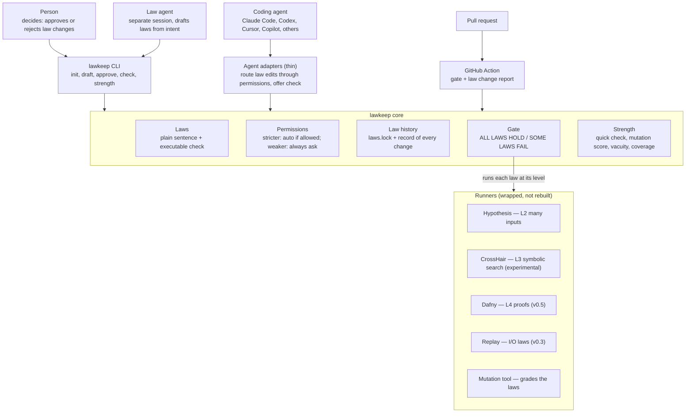

# lawkeep — Plan

As of 2026-11-21. Online copy (not yet updated with the 2026-11-20/21 decisions): https://claude.ai/artifact/G7arfaBoWxtTYTLUTx1Zhr

## Summary

lawkeep is an open-source layer for AI-assisted coding. Coding agents write and maintain the rules (laws) the code must obey, people decide on those laws, every law change is recorded and shown, and one gate says pass or fail.

- **Headline:** *Only review what your laws don't protect.* On every change, lawkeep shows which parts are protected by laws and which a person still needs to read.

- **Promise:** every law is checked; the AI never changes a law silently; weakening a law needs a person's yes; and lawkeep tells you when your laws are too weak to catch real bugs.
- **Not a promise:** absolute correctness, or that an agent *cannot* get around lawkeep. A guarantee is only as strong as the laws, and lawkeep shows and records rather than polices.
- **Inspiration:** Bend 2's human-owned `LAWS.bend` plus a mechanical proof gate, brought to languages and coding agents people already use.
- **Status:** GitHub organization [github.com/lawkeep](https://github.com/lawkeep) created; the name `lawkeep` reserved on [PyPI](https://pypi.org/project/lawkeep/) and [npm](https://www.npmjs.com/package/lawkeep) (0.0.1 placeholders). Licence: Apache-2.0. The v0.1 code exists in the repository (built 2026-11-21/22, not yet committed or released); see `AGENTS.md` → "Current state" for what works and what is not done.

## Problem

Coding agents now write much of the code, and the usual safety net (example tests) was built for human authors. It fails in four ways when the author is an AI.

1. **Examples miss cases.** A test checks a handful of inputs; the code can be wrong for every input nobody tried.
2. **The agent can move the goalposts.** Asked to make a failing test pass, an agent may edit the test, weaken an assertion or skip it. Nothing marks that change as different from any other edit. Research confirms this happens often (see Landscape).
3. **Nobody knows how strong the tests are.** Agents tend to write tests that confirm what their code already does, so a green run can mean little.
4. **Nobody wants to write rules by hand.** Not even developers. Any approach that depends on people writing test code will not be used.

The human reviewer is left reading every line of a growing diff, which does not scale.

**Who it is for:**

- Teams and individuals who let coding agents (Claude Code, Codex, Cursor, Copilot and others) change production code.
- Developers and non-technical people alike, from v0.1: developers can use the `lawkeep` CLI directly; anyone can instead ask their coding agent, which runs the same CLI commands for them, so no one has to type commands or read code.
- People who want to decide on a short list of rules instead of reviewing every generated line.
- Tool builders who want a standard gate their agent can call.

## Principles

Six rules shape every design choice below.

1. **No new language.** Laws are written in the project's own language with libraries people already know. Adoption beats elegance.
2. **Agents write, humans decide.** Agents draft and maintain laws. People decide: changes that make laws stricter can run automatically if the user allows it; anything that weakens a law always needs a person's yes. Every law change is recorded and shown.
3. **Honest guarantees.** Every result says how strongly each law was checked, with evidence (inputs tried, planted bugs caught). Never claim more than that.
4. **Every coding agent from day one.** The core is a plain CLI and library; agent-specific parts are thin adapters. v0.1 already supports several agents. More programming languages come last.
5. **Wrap, don't rebuild.** Hypothesis, fast-check, CrossHair, mutation testers and Dafny already work. lawkeep adds the missing layer around them: drafting, permissions, law history, one gate, agent feedback and law-strength checks.
6. **Fit the team, don't police it.** lawkeep never forces a team process (such as mandatory GitHub reviews or branch protection). People approve in the flow they already use; lawkeep records and shows. Stricter setups are optional extras, off by default.

## Core concepts

lawkeep has six ideas: laws, permissions, the law history, the guarantee ladder, the gate, and law strength.

**1. Law.** A rule the code must obey for every input, with one plain-English sentence and an executable check. Laws live in `laws/` next to the code, together with everything they depend on (generators, fixtures, settings), so changing any of those counts as a law change. Agents write the check; people judge the sentence and concrete examples, not the code.

```python
# Drafted by the law agent from the request "refunds can never exceed the payment"
from lawkeep import law, given, st
from billing import refund

@law("A refund never exceeds the original charge")
@given(charge=st.charges(), amount=st.money())
def refund_is_capped(charge, amount):
    assert refund(charge, amount).total <= charge.total
```

**2. Permissions.** What an agent may do to laws depends on the direction of the change. The user sets this once in `lawkeep.toml`.

| Agent action | Effect | Default |
| --- | --- | --- |
| Add a new law | Stricter | Allowed; the user is told |
| Add an example or a saved failing case | Stricter | Allowed; the user is told |
| Update a law after a rename (e.g. `refund` → `issue_refund`) | Same meaning, confirmed by lawkeep (same results on the same cases, same planted bugs caught) | Allowed; the user is told |
| Change what a law checks | Unclear | Ask the user first |
| Loosen, delete or skip a law, or try fewer cases | Weaker | Always ask the user (cannot be set to automatic) |

```toml
# lawkeep.toml
[permissions]
add_law       = "auto"
rename_target = "auto"
change_law    = "ask"
weaken_law    = "ask"    # fixed
```

The "yes" comes from a person in the flow they already use: the coding agent's own permission prompt where it has one, otherwise lawkeep asks the person directly.

**3. Law history.** Every law change is recorded: what changed, which agent made it, why, which permission allowed it, and who said yes. `laws.lock` keeps a fingerprint (hash) of every law and its dependencies so lawkeep can spot a law that changed without going through lawkeep and flag it loudly as an **unrecorded law change**. Changes to known side-door files (`conftest.py`, `sitecustomize.py`, cached `.pyc` files, skip markers) are flagged too. lawkeep flags; the person decides what to do.

At the end of each agent session, and on each pull request, lawkeep shows one plain-English report:

```
lawkeep · law changes in this session
  + ADDED    R7 "A refund is never negative"            auto (stricter) · catches 4 of 4 planted bugs
  ~ UPDATED  R3 now checks issue_refund()               auto · same meaning, confirmed
  ! WAITING  R2 "Fee is always 2%" → "Fee is 2%, or $0 for refunds under $1"
             LOOSER: needs your yes · why: your request "no fees on tiny refunds"
             now allowed: refund $0.50 → fee $0.00
```

**4. Guarantee ladder.** Each law is checked by the strongest method that works for it, and the report names the level reached, with evidence (for example "L2 · 2,000 cases · 5 of 6 planted bugs caught").

| Level | Method | Tools | Fits |
| --- | --- | --- | --- |
| L1 Examples | Fixed examples | pytest | Anything |
| L2 Many inputs | Property-based testing with shrinking | Hypothesis, fast-check | Most logic |
| L3 Symbolic search | Symbolic exploration with a solver; "all paths" only when the tool reports it exhausted them | CrossHair, Z3 | Pure functions |
| L4 Proven | Machine-checked proof, compiled to the target language | Dafny (later Lean, Verus) | Small critical pieces |
| Replay | Recorded real responses, fake clock, fake services | lawkeep replay | Code that does I/O |

**5. Gate.** `lawkeep check` runs every law and prints `ALL LAWS HOLD` or `SOME LAWS FAIL`. Exit codes and JSON output are stable, and each failure carries the smallest failing input so an agent can fix the code and retry. Pull-request checks use fixed examples so the same code always gets the same verdict; every failing input ever found is saved and retried on every run (agents may add to this list, never remove from it); a deeper random search runs nightly. If an agent believes a law conflicts with its task, stopping and asking is a normal, successful outcome, not a failure.

**6. Law strength.** A passing gate only means the code matches the laws. lawkeep also checks the laws themselves:

- **Quick check:** swap each function a law covers for dumb versions ("always 0", "always the input", "always an error"); a law that still passes is flagged. Every new law must pass this before approval.
- **Mutation score:** plant small bugs in the code and report laws that catch none.
- **Vacuity:** flag laws that pass whatever the code does, or whose input generator rarely reaches the interesting cases.
- **Coverage:** list public functions no law touches.

## Architecture

A person, any coding agent and CI all reach the code through the same core. The core runs each law with the strongest runner that fits and records every law change.



Every agent adapter sits on the same shared base: the CLI, an MCP server (`check`, `propose`), an `AGENTS.md` snippet and a git pre-commit hook. Agents with their own hooks and permission prompts get a richer adapter on top of that base; any other agent still works through the base.

lawkeep shows and records; it does not enforce a team process. A determined agent could still edit files directly, which is why the promise is "never silently" rather than "cannot": such edits show up as unrecorded law changes. Teams that want stricter enforcement can switch on the optional strict mode (v1.0).

## Workflow

People spend their time deciding; agents spend theirs writing laws, code and retries.

**Setting up laws**

1. `lawkeep init` adds `laws/`, `laws.lock`, `lawkeep.toml` (permissions), CI config and the adapter for the coding agent(s) in use.
2. `lawkeep draft <module>` runs a separate law agent that proposes laws from the user's request, docs and the module's public functions. The law agent is a fresh, separate session of the user's own coding agent (no extra account or API key). It writes from what the user wanted, not from what the code currently does.
3. Each draft must pass the quick strength check; drafts that catch no planted bugs are flagged.
4. The person reviews each law as a sentence plus a table of concrete examples (for example "payment $40, refund $50 → rejected ✓") and approves or rejects. Approved laws move into `laws/` and the law history.
5. `lawkeep strength` reports mutation score, vacuous laws and uncovered functions, so the person knows where laws are thin.

**Daily coding**

1. The agent changes code. Law changes go through lawkeep and follow the permissions in `lawkeep.toml`.
2. Before finishing, the agent runs `lawkeep check` (CLI or MCP tool).
3. On `SOME LAWS FAIL`, it reads the smallest failing input from the JSON report, fixes the code and checks again.
4. If the agent believes a law is wrong, it stops and asks for a change (`lawkeep propose`). Weakening changes wait for a person's yes.
5. At the end of the session, and on every pull request, lawkeep shows the law change report. Any law changed outside lawkeep is flagged as an unrecorded law change.

## How it works under the hood

lawkeep coordinates existing tools; its own code handles fingerprints, history, permissions, clean runs and reports.

| Tool | Used for |
| --- | --- |
| pytest | Finding and running laws (each law is a pytest test) |
| Hypothesis | Generating inputs, shrinking failures, saving failing examples |
| CrossHair | Experimental smarter input selection (Hypothesis backend) |
| coverage.py | Which functions each law touches; functions no law touches |
| mutmut | Planted bugs for grading and the protection report (the v0.1 build uses its own small mutation step instead, a deliberate exception approved 2026-11-23; see Decisions) |
| git | What changed (protection report, side-door scan) |
| The user's coding agent | Writing laws (`draft`) in a separate non-interactive session |

**`lawkeep check`** runs only the laws in `laws/`, never the project's existing test suite (existing tests stay as they are).

1. Read `lawkeep.toml`.
2. Integrity check: fingerprint every file in `laws/` and compare with `laws.lock` and the history (mismatch → unrecorded law change); scan the git diff for side-door files (`conftest.py` outside `laws/`, `sitecustomize.py`, `.pth`, cached `.pyc`, skip/xfail markers). No code runs in this step.
3. Start a fresh Python process running pytest on `laws/` only, with outside conftest files and auto-loaded plugins disabled (`--noconftest`, `PYTEST_DISABLE_PLUGIN_AUTOLOAD=1`) and only lawkeep's plugin and `laws/` fixtures loaded.
4. For each law, Hypothesis replays saved failing examples, then generates new ones with a fixed seed, calls the real code, shrinks any failure to the simplest example, and saves it.
5. lawkeep's pytest plugin records per law: result, examples tried, simplest failing example, time.
6. Report in plain English and JSON. Result codes: 0 all hold, 1 some fail, 2 waiting for a person's decision, 3 setup problem. `check` only reads files, except for adding newly found failing examples.

**One way of running laws.** `check`, `strength` (with the protection report and planted bugs for `propose`) and the example tables of `draft`/`approve`/`propose` all start laws through one law-running core (`lawkeep/lawrun.py`) in one of three modes: `check`, `strength`, `probe`. Every mode gets the same clean start (`python -I -S -B` with lawkeep's start-up script: no `sitecustomize.py`, `.pth` code, `PYTHONPATH` or cached bytecode; outside conftest files and auto-loaded plugins off; no `LAWKEEP_*` variable from the caller's shell), the same request sent on the process's input, and the same private results pipe that is written once and closed. Nothing is written into the project.

**`lawkeep strength`**

1. Run laws under coverage.py to map each law to the functions it touches.
2. Quick check: temporarily swap each touched function, in the test process only, for dumb versions (always 0 / the input / an error); a law that still passes is flagged.
3. Planted bugs: copies of the code with one small change each (planned: mutmut; the v0.1 build plants them in memory with its own mutation step, a deliberate exception approved 2026-11-23); lawkeep reports caught vs missed per law.
4. Weak test data: Hypothesis statistics show when generated examples rarely reach the interesting cases.
5. Gaps: public functions no law ran. Full planted-bug runs are nightly or on demand.

**Protection report:** git diff against the base branch → changed lines mapped to functions (by reading the Python files) → planted bugs only in those functions → run laws → each function labelled protected (all caught), partly, or not protected.

**`lawkeep draft`:** collect the user's request, pointed-to docs and the module's function names and descriptions (not the code being changed); start a separate non-interactive session of the user's coding agent that writes laws into `laws/drafts/` and input descriptions into `laws/strategies.py`; then lawkeep checks each draft runs, whether it passes on today's code (a failure is shown to the user, who decides whether the code or the law is wrong), and the quick check. Drafts are ignored by the gate until approved.

**`lawkeep approve`:** ask Hypothesis for a few varied inputs including edge cases, call the real code, show input → result → law holds?; ask yes/no (agent permission prompt, or terminal); on yes move the law into `laws/`, update `laws.lock`, append to `laws/history.jsonl`.

**`lawkeep propose`:** the agent submits a new law version and a reason; lawkeep decides the direction by evidence, running old and new versions on the same examples and planted bugs (rejects more → stricter; identical → same meaning; accepts cases the old one rejected → looser; mixed → ask); applies permissions; records the result in the history either way.

**Other pieces:** the end-of-session report reads history entries since the session started plus the integrity check. The GitHub Action uses a fresh checkout, runs `check` and the protection report, and posts one comment without blocking merges. Agent adapters turn direct edits to `laws/` into `propose`, expose `check` and `propose` as MCP tools, add `AGENTS.md` instructions, and install a pre-commit integrity check.

## v0.1 scope: the trustworthy core

v0.1 is Python only, supports several coding agents from the start, and works for developers and non-technical people alike. It covers levels L1 and L2 (L3 experimental), agent-drafted laws, permissions, the law history, law strength and the protection report. v0.1 ships everything below together (decided 2026-11-21).

**In**

- Python SDK: `@law` on pytest tests, input generators re-exported from Hypothesis, a plain-English sentence per law. Python 3.10+, managed with uv.
- `lawkeep init`, `draft`, `approve`, `check`, `strength`, `propose`.
- Law drafting by a separate law agent: a fresh session of the user's own coding agent; every draft must pass the quick strength check; approval by sentence plus example table.
- **Protection report** ("only review what's unprotected") on every pull request and at the end of each session: plant bugs only in changed code and show which parts no law protects.
- **CLI first, usable without typing it:** every action is a `lawkeep` CLI command (with `--json` output) that developers can run themselves and coding agents run on the user's behalf. A non-technical user just asks their coding agent ("add a law that refunds never exceed the payment"), and the agent runs the commands; reports, questions and errors are in plain English with concrete examples.
- Permissions in `lawkeep.toml`: stricter changes can be automatic, weakening always asks.
- Law history: one `laws.lock` file with fingerprints of laws and everything in `laws/`, plus a record of every change in `laws/history.jsonl` (what, why, which agent, which permission, who said yes); unrecorded law changes and side-door files are flagged.
- End-of-session and pull-request law change report in plain English.
- Gate: fixed examples on pull requests, saved failing inputs replayed on every run, nightly deep search; smallest failing input for every failure; "stop and ask" as a normal outcome; JSON report with stable exit codes.
- Runners: Hypothesis (L2); CrossHair as Hypothesis's symbolic backend (L3), marked experimental.
- Law strength: quick check (dumb function versions), mutation score with an existing Python mutation tester, vacuity and coverage checks.
- Reports show evidence (cases tried, planted bugs caught), not just a level.
- Agent adapters from day one: Claude Code, Codex, Cursor and GitHub Copilot, all thin and on one shared base (CLI, MCP server with `check` and `propose`, `AGENTS.md` snippet, git pre-commit hook) so any other agent also works. Each adapter uses the agent's own hooks and permission prompt where it has them.
- A GitHub Action that runs the gate and posts the law change report. It does not require any review process.
- Cheating test suite: scripted known tricks (editing a law or helper, `conftest.py` and `sitecustomize.py` patches, `.pyc` patches, skip markers, "try 1 case", special-casing a failing input), each shown to be caught and reported.
- Docs and two example projects with made-up code (no code from any private project).

**Out (later)**

- Real-database laws, permissions law, free laws, fast agent profile (v0.2).
- Fake outside services and replay (v0.3).
- Race-condition laws (v0.4).
- L4 proofs with Dafny (v0.5).
- Other programming languages: TypeScript, Go and more (v0.6, last).
- Optional strict mode (v1.0).
- Any hosted service.

**Done when**

- [ ] Both example projects pass `lawkeep check` in CI.
- [ ] A planted bug in each example fails the gate with a minimal failing input.
- [ ] `lawkeep draft` produces laws for an example module, and each one catches at least one planted bug.
- [ ] In each supported agent (Claude Code, Codex, Cursor, Copilot), asked to make a failing law pass, the agent fixes the code or asks to change the law; a weakening change is never applied without a person's yes.
- [ ] A law edited by hand outside lawkeep is flagged as an unrecorded law change.
- [ ] Every trick in the cheating test suite is caught and reported.
- [ ] The end-of-session report lists every law change made in the session.
- [ ] On a change with a planted, unprotected bug in an example project, the protection report marks that code as unprotected.
- [ ] A non-technical tester sets up lawkeep, approves laws and reads the reports only by talking to a coding agent, without terminal commands or reading code.
- [ ] `lawkeep strength` flags a deliberately vacuous law.
- [ ] Tried privately on at least two real modules before the public announcement.
- [ ] About 30 made-up tasks run with and without lawkeep, and the results published with the announcement.

## Roadmap

After v0.1, each release covers more of the code real teams ship, then stronger guarantees, and other programming languages come last. No dates are set yet.

1. **v0.2 Real apps** (Python)
   - Run the code under test in a separate process from the law runner, so code written to sabotage the checks (e.g. patching Hypothesis) can no longer change results (removes the main known limit of v0.1).
   - Laws over sequences of operations against a real database (Hypothesis stateful testing), with a fresh database state for each run.
   - Test data built by calling the app's own actions, with a warning when generated data rarely reaches the important cases.
   - Permissions law: a "who can do what" table tested on every endpoint, marked records to detect data leaks, and a flag for new endpoints not yet in the table.
   - Free laws: "never crashes on valid input" (Hypothesis ghostwriter) and "a refactor doesn't change behavior" (compared with the main branch).
   - Safe law updates after renames, confirmed same meaning.
   - Fast agent profile: under a minute, running only laws affected by the change and caching results.
2. **v0.3 Outside services**
   - Fake services that fail on purpose (timeouts, errors, duplicate or late messages), driven by Hypothesis.
   - Fake clock, so waits and retries happen instantly.
   - Replay: record real responses and warn when a fake drifts from them.
   - Reports say "checked against a fake: only as good as the fake".
3. **v0.4 Race conditions**
   - Laws that control the order of each request's database statements and try every order (look at isolab, frontrun and interleave-test first).
   - The exact bad ordering shown when a law fails; reports say clearly what is not covered (races inside program memory, across services).
4. **v0.5 Proofs**
   - L4 through Dafny for small, critical, pure pieces, compiled to the target language and checked by the same gate. The only level allowed to say "proven".
5. **v0.6 Other programming languages** (last)
   - TypeScript on fast-check, then Go and others driven by demand.
6. **v1.0 Stable**
   - Stable law format, permissions format, law history format, report schema and adapter interface.
   - Optional strict mode for teams that want hard blocking, off by default.

## Landscape

The checking tools exist, and so do pieces of the idea. What is missing is one agent-agnostic layer that drafts laws, records every change, asks before weakening, and grades the laws.

| Project | What it does | What we take | How lawkeep differs |
| --- | --- | --- | --- |
| [Bend 2](https://github.com/bendlang/bend) | New language; human `LAWS.bend`, AI `PROOF.bend`, compiler gate | Human-decided laws, one gate, agent guide built in | No new language; graded guarantees instead of proof-or-nothing; I/O code covered |
| [Kiro](https://kiro.dev/docs/specs/correctness/) | AI editor; turns written requirements into Hypothesis property tests | Laws drafted from intent | Kiro's tests can be edited by the agent with no record or approval, there is no strength measure, and it works only inside its editor |
| Test-lock tools (agentlock, donttouch and others) | Make test files read-only or hash them | Detecting changes to protected files | lawkeep records and explains changes, allows safe ones, asks before weakening, and grades the laws |
| Dafny | Verified language that compiles to Python, Go, JS and others | L4 backend | Used only for small critical pieces, behind the same gate |
| Hypothesis / fast-check | Property-based testing | L2 runner, generators, shrinking | Adds drafting, permissions, law history, gate, agent feedback, strength checks |
| CrossHair | Symbolic checking of Python with Z3 | L3 runner | Same as above |
| Mutation testers | Plant bugs to grade tests | Law-strength score | Applied to laws, reported per law |

Research points the same way:

- [ImpossibleBench](https://arxiv.org/abs/2510.20270) (ICLR 2026): coding agents often cheat on impossible tasks, by editing tests or hard-coding the tested inputs; giving them a way to stop reduced cheating.
- [CircumEval](https://lesswrong.com/posts/GHrqBKr8GLpbce6mN/door-s-locked-try-the-window) (June 2026): even with files truly read-only, agents got around them in most runs (through `conftest.py`, `sitecustomize.py`, patched `.pyc` files, `skip`/`xfail`) when the honest path was blocked; explicit "stop and report" instructions brought this to zero. This is why lawkeep records and shows rather than claiming agents *cannot* get around it, and why "stop and ask" is a normal outcome.
- [Spec-Driven PBT](https://neurips.cc/virtual/2026/171477) derives properties from requirements, [LeetProof](https://www.alphaxiv.org/abs/2604.16584) checks specs with property tests before writing code, and ["The Prover Is the Judge"](https://codex.danielvaughan.com/2026/07/18/prover-is-the-judge-verified-security-software-coding-agents-ada-spark-codex-cli-verifier-driven-feedback-loop/) shows a proof is only as good as its spec, which is why law strength is part of v0.1.

## Risks

The biggest risk is that laws end up weak or wrong without anyone noticing, so v0.1 makes every law prove it can catch bugs and shows people concrete examples.

| Risk | Mitigation |
| --- | --- |
| The same agent writes a weak law and matching buggy code | Separate law agent that drafts from intent, not from the code change; every law must catch planted bugs; people review examples |
| Approval fatigue: people click "yes" without reading | Stricter changes can be automatic; questions are batched into one short report; only weakening always asks |
| False confidence from weak laws | Strength report on every run; evidence in every report; never use the word "proven" below L4 |
| Agents get around lawkeep (editing files directly, special-casing inputs) | Unrecorded law changes and side-door files flagged loudly; saved failing inputs replayed forever; "stop and ask" as a normal outcome; cheating test suite; honest promise ("never silently", not "cannot"); optional strict mode |
| Being seen as restrictive | No forced team process; approval happens in the flow people already use |
| v0.1 is large (several agents, non-technical users, protection report) and takes long for one maintainer | Accepted on 2026-11-21 in exchange for a complete first release; shared core, thin adapters; private pilot before launch |
| Supporting several agents from day one stretches one maintainer | Adapters stay thin on one shared base (CLI, MCP, `AGENTS.md`, pre-commit hook); the core does the work; other languages wait until last |
| Agents differ in hooks and permission prompts | Shared base works everywhere; richer adapters only where the agent supports it |
| Slow gate (property and mutation runs) | Fixed examples on pull requests, deep search nightly; fast agent profile in v0.2; cache results by code hash |
| Upstream tools change or stall | Thin runner interface per backend; pin versions |
| "Foolproof" over-promising hurts trust | Honest promise in every README and report |

## Decisions

| Date | Decision |
| --- | --- |
| 2026-11-19 | Name `lawkeep`, Apache-2.0, laws in the project's own language, Python first. |
| 2026-11-20 | Agents write laws; humans decide. Every law action is permissioned and clearly shown to the user. |
| 2026-11-20 | Permissions follow the direction of a change: stricter changes may be automatic; weakening always needs a person's yes. |
| 2026-11-20 | Law history and an end-of-session / pull-request law change report; laws changed outside lawkeep are flagged. |
| 2026-11-21 | No enforced team process. lawkeep records and shows; approval happens in the team's own flow; strict enforcement is an optional extra, off by default. |
| 2026-11-21 | Promise reworded: "the AI never changes your laws silently; weakening needs your yes" (not "the AI cannot weaken them"). |
| 2026-11-21 | Roadmap adopted: v0.1 trustworthy core, v0.2 real apps, v0.3 outside services, v0.4 race conditions, v0.5 proofs, v0.6 other languages, v1.0 stable. |
| 2026-11-21 | Several coding agents supported from v0.1 (Claude Code, Codex, Cursor, Copilot, plus any agent through the shared base); other programming languages come last (v0.6). |
| 2026-11-21 | Headline: "Only review what your laws don't protect." The protection report moves from v0.2 into v0.1. |
| 2026-11-21 | v0.1 is for developers and non-technical people alike. Everything is a CLI command that developers can run directly and coding agents run on the user's behalf, so non-technical users never have to type commands or read code. |
| 2026-11-21 | The law agent is a fresh, separate session of the user's own coding agent (no extra account or API key). |
| 2026-11-21 | v0.1 ships everything planned together; no trimming. |
| 2026-11-21 | Mechanics adopted (see "How it works under the hood"): `check` runs only laws, not existing tests; result codes 0/1/2/3; law-change direction decided by evidence, unclear cases ask; `draft` runs the user's agent in a separate non-interactive session (support to be confirmed per agent during the build). |
| 2026-11-21 | Defaults accepted: laws as `@law` on pytest tests; one `laws.lock` file; law history in `laws/history.jsonl`; build the quick strength check (after confirming no existing tool does it) and wrap mutmut or Cosmic Ray for full runs; Python 3.10+ with uv. |
| 2026-11-22 | **(approved 2026-11-23)** Foundation choices: `lawkeep.toml` is fingerprinted like a law file; an unrecorded law change makes `check` return 2 (waiting for a person), with precedence 3 > 1 > 2 > 0 when several apply; `draft` returns 2 because drafts always wait for a person. |
| 2026-11-22 | **(approved 2026-11-23)** Permission mapping: stricter → `add_law` (or `add_example`); same meaning → `rename_target`; unclear → `change_law`; looser, delete, skip or fewer cases → `weaken_law`, which always asks even if `lawkeep.toml` says otherwise. |
| 2026-11-22 | **(approved 2026-11-23)** "Same meaning" (applied automatically under `rename_target`) needs three things: at least one case that both versions reject, the same results on the same cases and planted bugs, **and** a new law that differs from the old one only in names. Any other edit with the same results counts as unclear, so a person decides. Added during integration: `<= charge.total` → `<= charge.total + 1` gave the same results on every case tried (today's code never produces such a refund) and was applied without a yes. Side effect: renaming a law's own arguments also asks. |
| 2026-11-22 | **(approved 2026-11-23)** Gate details: tests in `laws/` without `@law` are ignored and listed in a note, not treated as a setup problem. The "pr" profile uses a fixed seed per law instead of Hypothesis `derandomize=True`, because that setting turns off the example database and saved failing examples could not be replayed; the same code with the same saved examples still gets the same verdict. The gate's Python also runs with `-I`, `-B`, an empty bytecode cache folder and an empty pytest config, so `sitecustomize.py`, `PYTHONPATH`, patched `.pyc` files and the project's own pytest options cannot change it. Only the fixtures of `laws/conftest.py` load (its hooks are ignored and flagged). A skipped law counts as neither holding nor failing. |
| 2026-11-22 | **(approved 2026-11-23 (recorded as a deliberate exception to "wrap, don't rebuild"))** Planted bugs come from lawkeep's own small mutation step (operators modelled on mutmut's, bugs only in memory), not from mutmut. This departs from "wrap mutmut or Cosmic Ray": mutmut 3 can only be driven through its CLI, copies the project into a `mutants/` folder inside the working tree, runs the whole test suite, and cannot plant bugs only in chosen functions or say which law caught each bug, which the protection report needs. It also does not run on Windows. `[strength] mutation_tool` is ignored for now. |
| 2026-11-22 | **(approved 2026-11-23, option B: merge the three ways of running laws into one before the first commit)** Three ways of running laws, all with the gate's isolation rules: the gate's runner (`check`); one strength process that measures coverage per law and swaps functions in memory (`strength`, protection report, planted bugs for `propose`); and a small probe process that records each input and result for example tables (`draft`, `approve`, `propose`). **Done 2026-11-23:** merged into one law-running core with three modes; see the 2026-11-23 row "One law-running core". |
| 2026-11-22 | **(approved 2026-11-23 with a change: edits the drafting agent makes to approved laws or `lawkeep.toml` are no longer just undone; they become waiting proposals for the person to review — approve applies them, reject drops them; the files go back to the approved version while the proposal waits, so nothing is lost)** Drafting: the drafting agent may only add new generators to `laws/strategies.py` (recorded automatically as `add_strategy` when `add_law` is "auto", otherwise parked in `laws/drafts/strategies.py` until a person approves a draft). Any other edit it makes to a file `laws.lock` fingerprints (an approved law, an existing generator, `lawkeep.toml`, a helper in `laws/`) is put back to the approved version and becomes one waiting proposal per file (`lawkeep.draft_edits`), with the direction judged as in `propose`, actor = the drafting agent and reason "edited by the drafting agent during `lawkeep draft`" (plus the agent's own `Changed <path>: <why>` line, if any). These proposals are never applied automatically, even when stricter, and `approve --yes` without ids does not decide them; `approve` applies (the whole file, refused if it or the target changed meanwhile) or rejects each one. A draft file is the unit of approval. Implemented 2026-11-23. |
| 2026-11-22 | **(approved 2026-11-23)** Proposals: a weakening or unclear proposal waits in `laws/drafts/proposals/<id>/`. Its hashes are kept in the append-only history, and `approve` refuses it if the proposal or the target file changed after it was recorded. `propose --file laws/drafts/x.py` removes `x.py` once the proposal is recorded. |
| 2026-11-22 | **(approved 2026-11-23)** Adapters: the pre-commit hook shows problems and does not block, unless the person runs `git config lawkeep.precommit block` (a git setting rather than a `lawkeep.toml` key, so turning it on is not itself a law change). The MCP server has no `approve` tool; the person's yes comes from the agent's own permission prompt or the terminal. Agent hooks always exit 0 and put the decision in the agent's own format. The guard also protects `lawkeep.toml` and pending proposals. In Copilot's cloud agent and autopilot, "ask" counts as "deny". |
| 2026-11-22 | **(approved 2026-11-23 (follow-up: find a safer Copilot setting than `--allow-all-tools`, or warn clearly before it runs))** Agent launch commands for `draft`, checked against each agent's public docs but never run: `claude -p --permission-mode acceptEdits`, `codex exec --sandbox workspace-write`, `cursor-agent -p --force`, `copilot -p --allow-all-tools` (which also lets Copilot run shell commands). **Follow-up done 2026-11-23:** see the 2026-11-23 row "Copilot drafting preset". |
| 2026-11-22 | **(approved 2026-11-23)** The protection report only shows, so its result code is always 0. `lawkeep report` returns 2 when a decision is waiting or an integrity problem needs a person. |
| 2026-11-22 | **(approved 2026-11-23 (follow-up: roadmap task to run the code under test in a separate process))** Fixes after the acceptance and tamper review. (1) The gate, the strength worker and the example probe all start Python with `-I -S -B` through a small start-up script that adds site-packages and the folder lines of `.pth` files without running any `.pth` code, `sitecustomize.py` or `usercustomize.py`; so a fresh virtualenv's `_virtualenv.pth` no longer makes `check` wait, and changed `.pth` files in site-packages are a warning, not an error. (2) The code under test runs in the same process as the law runner and is **trusted**; this is now said in the README ("Known limits"). Mitigations: results travel through a pipe the plugin writes once and closes; the plugin removes `LAWKEEP_*` variables before project code is imported; the caller's `LAWKEEP_*` variables are dropped; a new `source_side_door` check flags source files that import lawkeep/pytest/Hypothesis, mention `LAWKEEP_*`, raise skips, define comparisons that always return `True`, or shadow a standard-library or installed module (error when changed since the git base). (3) Amends the 2026-11-22 gate decision: a skip raised while a law runs, or in set-up without a skip marker, is an **error**, not "skipped"; so is `assume()` called from outside `laws/`. Only a `skip`/`skipif` marker written on the law counts as skipped. (4) Amends the "same meaning" decision: a rename must be a consistent one-to-one renaming of names (two old names may not become one), attribute and keyword names and decorators must stay identical, built-ins may not be renamed, and a renamed outside function must no longer exist under its old name (an import alias is fine). A change to a law's input generators or settings is never "stricter" or "same" on its own: it asks. One changed number in an assert's comparison that widens the limit is labelled looser. (5) `approve`: `--accept-unrecorded` without ids decides only the hand edit (with a static review of what got looser, compared with the last commit); `--yes` without ids never decides a weakening proposal; with no terminal `--yes` needs `--channel` or `--by`, the person is never taken from git, and entries record `terminal`; `check`/`report` list approvals added without a terminal (`approval_unconfirmed`). lawkeep records who *claimed* to approve; it cannot authenticate a person. (6) A new law proposed with `propose` must pass the quick strength check to be applied automatically; otherwise it waits. Re-proposing the same text records nothing (`decision: unchanged`); a proposal refused because of an unrecorded change keeps the proposed file (`decision: refused`). (7) `.github/workflows/lawkeep.yml` is fingerprinted in `laws.lock` like `lawkeep.toml` and protected by the guard. (8) `history.record_change` refuses to record anything while an append-only file has lost lines. (9) `check --law` with an unknown id is a setup problem (3), and a `--law` run says it is partial. (10) MCP configs fall back to `<project>/.venv/bin/lawkeep` like the hooks. |

| 2026-11-22 | Terminal output uses **Rich** (tables that fit the window, colour, boxes; plain text when not a terminal or with `NO_COLOR`). No Typer/Click: commands stay on argparse. `--json` output is unchanged. |
| 2026-11-22 | Every command's wording is rewritten for someone with no background: lead with the verdict, explain every number in context (not "holds on today's code (46 examples tried)" but what was tried and what it means), explain each input of a law, push internal ids and paths into the background, and always say what to do next. Weak laws get a clear warning and a recommendation on the approve screen. |
| 2026-11-22 | **(approved 2026-11-23)** How the output redesign was built: one shared module `src/lawkeep/ui.py` (Rich; plain ASCII text when not a terminal, in CI, with `NO_COLOR` or `TERM=dumb`; `LAWKEEP_COLOR=always` forces colour) plus `src/lawkeep/explain.py` (shared sentences), rules in `docs/OUTPUT-STYLE.md`. `@law` gains an optional `inputs={"name": "plain description"}` (read statically; when missing, lawkeep says e.g. "a sample charge that lawkeep made up for testing" and suggests adding descriptions); the draft prompt asks the agent to always fill it in. `check` and `strength` get `--details`/`-v`. Failure messages are translated ("The law expected 0.25, but the code gave 0.26."). `--json` keeps its schema; a few plain-text values inside it were reworded (history `details.evidence` for new approvals, the check note about saved failing inputs, the pre-commit summary when nothing is flagged). The approve screen flags a likely duplicate when an approved law's sentence is almost the same (text similarity, not meaning). |
| 2026-11-22 | **(approved 2026-11-23)** Polish after the output redesign. (1) Strength: the quick check no longer treats a law's own inputs or local variables as calls (a parameter named `charge` made it swap the function `charge()`, a false "one-sided" flag); and a law that only checks a limit is no longer flagged when another *approved* law in the same run catches every deliberately broken version it lets through (drafts never count; the law gets a note naming its companions instead). The JSON flags keep their "One-sided:" / "Vacuous:" prefixes. (2) The examples got exact-answer companion laws through real `lawkeep propose` runs (applied automatically as stricter after passing the quick check): billing `discount_amounts.discount_takes_off_exactly_what_it_promises`; bookings `slot_overlap.slots_overlap_exactly_when_they_share_time` and `free_slots.free_means_no_shared_time`. Both examples now have 6 laws and `lawkeep strength` reports no weak laws; no existing law was changed or removed. (3) Inputs are shown in words (`src/lawkeep/readable.py`, generic rules from field names, raw value under `--details`/JSON); example tables are one row per example with a short Note column; ids wrap at dots; the "UNRECORDED LAW CHANGE:" messages, direction explanations and long strength suggestions were reworded. |
| 2026-11-23 | Static type checking with **pyright** (not mypy): matches what VS Code/Cursor developers already see, faster, checks more by default. `src/lawkeep` is checked in **strict** mode (professional-library level), tests in standard mode; pyright runs in CI next to ruff; the package ships a `py.typed` marker so projects using lawkeep get its type hints. Suppressions only with a specific rule and a reason. |
| 2026-11-23 | **(approved 2026-11-23)** How type checking was built: `[tool.pyright]` in `pyproject.toml` (strict for `src/lawkeep`, standard for `tests`, `pythonVersion = "3.10"`, `examples/` and `tests/fixtures/` excluded, `typeCheckingMode` set explicitly so basedpyright in editors behaves the same); `enableTypeIgnoreComments = false`, so only `# pyright: ignore[rule]  # reason` silences an error (6 in `src`, all at untyped pytest/Hypothesis boundaries or runtime guards); `tomli` is a dev dependency so the Python 3.10 import branch is checked; CI runs `uv run pyright` in the `lint` job after `uv sync --locked --all-extras`. Code changes: JSON read from disk goes through new `models.as_dict` / `models.as_list`; `from_dict` now raises `TypeError` when a list/dict field holds another kind of value, so a hand-edited `laws/history.jsonl` line is a clear "not a valid history entry" error instead of a crash later (`tests/test_typing_fixes_core.py`); `examples_table` raises a clear `ImportError` when Python cannot build an import spec for a law file (`tests/test_typing_fixes_lifecycle.py`); `mcp_server` describes the MCP SDK server with a small `Protocol`; `_law.is_state_machine` is no longer private. The package ships `py.typed`. |
| 2026-11-23 | **(approved 2026-11-23 (the ordinary-numbers assumption is accepted))** Deterministic law-change direction (fixes the flaky `<= amount + Decimal("0.005")` → `+ Decimal("0.05")` label, LOOSER or UNCLEAR at random). Cause: the example probe relied on Hypothesis `derandomize`, which hashes the test function; the probe swaps in a recorder whose signature repr holds object addresses, so the seed changed every run. Rules now: (1) the probe always sets an explicit seed (`_hypothesis_internal_use_seed`, what `@seed` sets) — for `propose`, `direction_seed` = sha256 of the law id and both versions' source hashes; for example tables, a hash of the versions' files — and runs with `PYTHONHASHSEED=0`, no example database and a private `HYPOTHESIS_STORAGE_DIRECTORY` (nothing written into the project); (2) the evidence budget is a fixed 100 inputs per version (`DIRECTION_EXAMPLES`), no longer taken from the check profile; (3) static "limit moved" rule (`bound_direction`): when the only difference is one comparison with a single `<`, `<=`, `>`, `>=` or `==` that sits in an `assert` test reached only through `and`/`or` (no `not`, `if` test, `try`, `with` around it), one side unchanged, and the other side's limit `b` written as `rest + c`, `rest - c`, `c + rest` or a bare number (`c` a finite literal: int, float, unary minus, `Decimal("…")`, `float("…")`, `int(…)`, `Fraction(…)`), the old and new accepted values are compared as intervals over the reals: a superset is **looser** (always applied: it needs the person's yes), a subset is **stricter** (applied only when no tried input was refused by the old version but accepted by the new one, and nothing else in the file changed). Multiplication, `!=`, chained comparisons, two changed comparisons and flipped directions are left to the evidence. Assumption, said in the reason: ordinary numbers (`b + c` never wraps around; fixed-width integer types such as numpy's `uint8` would). Known non-determinism left: the probe's overall time limit (300 s) and the strength worker's per-run alarm can stop a run on a slow machine; a stopped probe gives `unclear` (never a looser label turned stricter), a stopped planted-bug run counts as caught. |
| 2026-11-23 | **(approved 2026-11-23)** The pre-tool-use guard judges shell commands by what they write to, not by what they mention (it had blocked ordinary source edits whose text named "laws" in a string). New `adapters/shellwords.py` (POSIX lexer: quotes, `$(...)`, backticks, here-documents, fd redirections, separators), `adapters/writes.py` (follows `cd`, variables, `for` lists, globs against the real folder, and a table of writing commands; read-only commands never count) and `adapters/pywrites.py` (inline Python and readable Python scripts via the syntax tree; `subprocess`/`os.system` commands analysed as shell; `sys.argv[N]` from the command line). Rules: deny a write to `laws/` (except `laws/drafts/` outside `proposals/`), `laws.lock`, `lawkeep.toml`, `.github/workflows/lawkeep.yml`; deny `rm -r`/`mv` of a folder that holds `laws/` or `laws/drafts/proposals/`; edit-tool paths and write targets are judged as written and with symlinks followed. A write whose target cannot be seen (`eval` of computed text, paths from `$(...)`/`read`/`xargs`, code piped in, unreadable scripts) is denied only when the command plausibly touches the laws: a word or a whole string literal in it is a protected-looking path (prose with spaces does not count), or it runs decoded code (`base64 -d | sh` and similar: hidden on purpose, so always plausible), or `find -exec`/`-delete` writes over a folder holding `laws/` without a `-name` filter that rules out every law file. Otherwise it is allowed. Unparsable commands (unbalanced quotes) get the same plausibility test on their text. `lawkeep approve`, also wrapped, still gets "ask". The same decision serves every agent's hook format. Not seen (documented in `writes.py` and `adapters/AGENTS.md`): what unknown commands do (`make`, `npm run`), run-time values, whole-tree git operations, unread archive/patch contents, symlinks made earlier in the same command. The guard stays a speed bump; `lawkeep check` flags any law file changed outside lawkeep regardless. |
| 2026-11-23 | **(approved 2026-11-23)** One law-running core (option B of the 2026-11-22 row, built): `lawrun.py` (parent) and `_lawrun_child.py` (child) start every law-running process, with modes `check` (gate plugin), `strength` (coverage, swaps, planted bugs) and `probe` (example tables, direction evidence). `isolation.py`, `strength/_run.py` and the probe's own start-up code were removed; the probe's child code moved to `_probe_worker.py`. Choices made while merging: the request goes in once on the child's stdin and results come back as JSON lines on the write-once pipe for every mode (strength and the probe used to use files); the pipe's number travels in the request, so no results variable is ever in the environment, and the gate plugin can no longer be switched on by environment variables at all; `runner.run_pytest(extra_env=...)` became `extra_sys_path=` / `ledger=`; strength now loads only the fixtures of `laws/conftest.py`, like the gate (it used to register hooks there too). Kept per mode on purpose: the gate keeps the caller's `PYTHONHASHSEED` (strength and probe use 0), strength runs without Hypothesis's pytest plugin, the skip/`assume()` rules stay the gate's. Same results as before on both examples (check, strength, report, with and without the planted-bug and unprotected-change patches) apart from durations; one billing example table drew two different inputs, because Hypothesis also takes constants from lawkeep's own source in an editable install (not in a wheel install). |
| 2026-11-23 | **(approved 2026-11-23)** Copilot drafting preset: `copilot -p {prompt} --no-ask-user --allow-tool 'read, write(laws/drafts/*), write(laws/strategies.py)' --deny-tool 'shell, url'` instead of `--allow-all-tools`. Copilot CLI's docs (command reference "Tool permission patterns", "Allowing tools") say `--allow-tool`/`--deny-tool` take `Kind(argument)` patterns, `write(src/*.ts)`-style paths are allowed, and deny rules always beat allow rules, so Copilot cannot run shell commands or fetch URLs while drafting. Not verified (Copilot was never run): whether a tool that is neither allowed nor denied is refused or stops a `-p` run, and whether `laws/drafts/*` matches every draft path. If it cannot write, the draft fails safely; `[agent] command` can widen it. |

| 2026-11-23 | Long runs without a person (v0.1): **park and keep going** — when a law blocks the agent and no person is there, it files a proposal with its reason, never works around the law, finishes the work that does not depend on it, and lists what is waiting in its final summary; and **one waiting list** — `lawkeep approve` shows everything that piled up (drafts, looser/unclear proposals, drafting-agent edits, unrecorded edits, unconfirmed approvals) in one place, with a count shown at session start and end. Weakening a law still needs a person's yes. **Built 2026-11-23 (choices approved 2026-11-23):** (1) the no-person rules are in the AGENTS.md snippet (new section "When no person is there"; also Cursor's rule and Copilot's instructions), the session-start reminder, the MCP instructions and `propose` tool description, and the draft prompt; with a person there, "stop and ask" is unchanged. (2) `person_present` is a documented guess (`presence.py`): `LAWKEEP_PERSON_PRESENT` 1/0, else `CI` → no, else stdin is a terminal → yes, else Claude Code `CLAUDE_CODE_SESSION_ATTENDED` 1/0, else `CLAUDE_CODE_ENTRYPOINT` `cli` → yes / `sdk-*` → no (seen in Claude Code 2.1, not a documented contract), else no; Codex, Cursor and Copilot interactive sessions read as "no", and the instructions say a person chatting with the agent counts as present. It never changes what lawkeep allows. (3) JSON is additive: `waiting_for_person` {count, ids, by_kind, items} and `person_present`/`person_present_reason` on `check`, `report`, `approve` and session-start; `propose` adds `person_present` and `next_step` ("Parked as h-… Continue with work that does not depend on this law; list h-… in your final summary …" when nobody is there). The name is `waiting_for_person` because `check`'s `waiting` already means pending proposals. Result codes are unchanged; the count never changes them. (4) `approve` with no ids lists all five kinds (laws changed outside lawkeep included, so a hand edit alone now makes the listing return 2 instead of 0); in a terminal: hand edits first, then "approve all recommended new drafts and stricter changes" when at least 2 items qualify (drafts whose every law works, is measured strong and is not a likely duplicate; stricter or same-meaning proposals that are not deletions, skips or weak new laws), then one by one. (5) An approval recorded with `terminal: false` stays on the list until someone in a terminal confirms it (`confirm_approval`) or undoes it (`undo_approval`: files restored from a copy kept in `laws/drafts/proposals/undo/<id>/` at approval time and checked against the history's fingerprints, else from git, else refused; an undone draft returns to `laws/drafts/`). Neither can be done without a terminal; `--yes`/`--no` with the approval's id in a terminal mean confirm/undo. The `approval_unconfirmed` warning in `check` skips confirmed or undone approvals. Only approvals with an explicit `terminal: false`, or flagged by the integrity check since the git base, count; older entries without the field (e.g. the examples' history) do not. |
| 2026-11-23 | First release is **0.1.0** on PyPI (package marked Alpha; the human-only "Done when" items — private pilot, non-technical tester, 30-task evaluation, real runs of other agents — stay open). Releases are published by `.github/workflows/release.yml` on a `v*` tag, with PyPI **trusted publishing** (no stored token); 0.1.0 itself is uploaded from the maintainer's machine. |
| 2026-11-23 | Repository conventions (`CONTRIBUTING.md`): trunk-based on `main` with short-lived `<type>/<short-description>` branches, Conventional Commits for commits and PR titles, squash-merge, SemVer written as PEP 440, annotated `v<version>` tags, Keep a Changelog 1.1.0 (`Unreleased` updated in each change; release notes come from it), GitHub environment `pypi`, Dependabot for Actions and `uv.lock`, `SECURITY.md` with private vulnerability reports. The first three commits on `main` predate these conventions and are left as they are (published history is not rewritten). |
| 2026-11-23 | Public repository setup for outside contributors: issue forms (bug, feature; blank issues off; questions go to Discussions, vulnerabilities to private advisories), Contributor Covenant 2.1 (reports through GitHub, no email address), `CODEOWNERS` (`* @abhishek19273`, a review request for this repository only), `.editorconfig`, pre-commit hooks that also run lawkeep's own pre-commit check and never touch fingerprinted law files, dependency review, a Conventional-Commits PR-title check, OpenSSF Scorecard, the onboarding guide on GitHub Pages; labels by type, area (`area: <command>`) and agent (`agent: <name>`); one milestone per roadmap version; open work (the v0.2 roadmap and known gaps) tracked as GitHub issues, with human-only items (pilot, tester, 30-task evaluation) kept out of public issues; a ruleset on `main` (pull request with 0 required approvals, required CI checks, linear history, no force pushes or deletion; organization admins may bypass) and squash-merge only. All of this applies to lawkeep's own repository and forces nothing on lawkeep's users. |
| 2026-11-24 | LLM-friendly documentation following the llms.txt convention (llmstxt.org): `llms.txt` (summary, key facts, result codes, the agent rules in short, links to Markdown pages; secondary docs under "Optional"), `llms-full.txt` (one self-contained Markdown reference, about 17k tokens) and `index.md` (the onboarding page as Markdown) at the docs site root, plus Markdown copies of the guides, README, PLAN, ARCHITECTURE, OUTPUT-STYLE, CHANGELOG and CONTRIBUTING. To keep them from drifting they are **generated**, not written: `scripts/build_llms_docs.py` (a repository script, not part of the installed package) fills hand-written templates in `scripts/` with the live CLI parsers, `action.yml`, the agent instructions snippet, `lawkeep.exitcodes`, the report dataclasses, the `@law`/`st` signatures, the MCP instructions and tools, quoted sections of README/ARCHITECTURE/guides, and converts `onboarding.html` with a stdlib HTML parser. The output is committed under `docs/`; `pages.yml` copies it; CI's `lint` job and `tests/test_docs_llms.py` fail when it is out of date. `scripts/` is checked by ruff and pyright (standard mode). Not done: a `lawkeep` command that prints the reference from the package (would ship a second copy; left as an idea). |

## Open questions

These can wait until v0.1 is nearly done.

- [ ] **More ways to decide during long runs (suggested for v0.2):** approve from a pull-request comment (`/lawkeep approve <id>`, recorded with the GitHub account; optional, off by default); decide in advance (the person pre-approves one exact law change before a run; anything different still waits). A second AI may summarise a request for the person but must never approve.

- [ ] **Pilot modules:** which two real modules to try privately before launch (they stay private and never appear in lawkeep's examples).
- [ ] **Launch plan:** where to announce, and whether to ship v0.1 before or after the pilot results.
